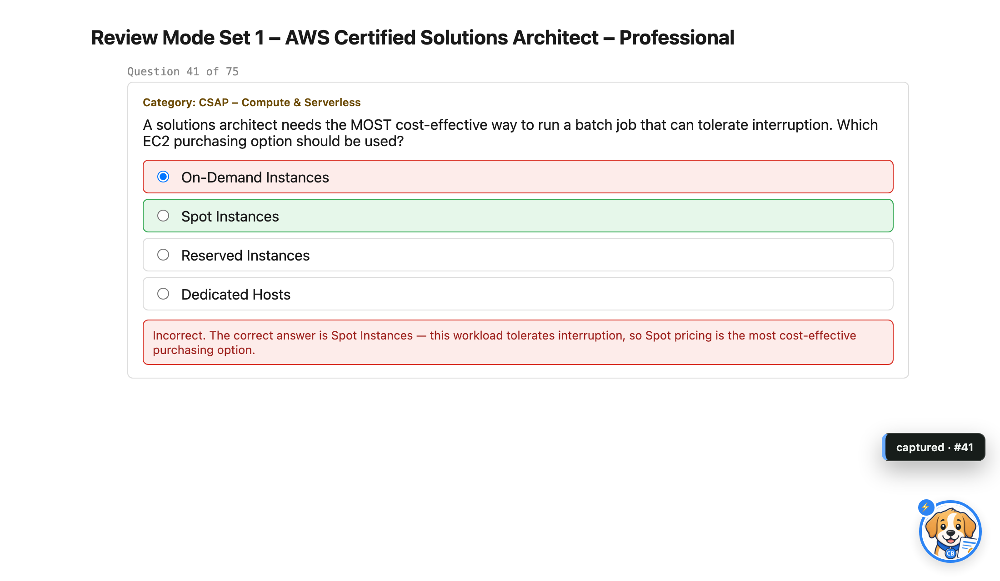
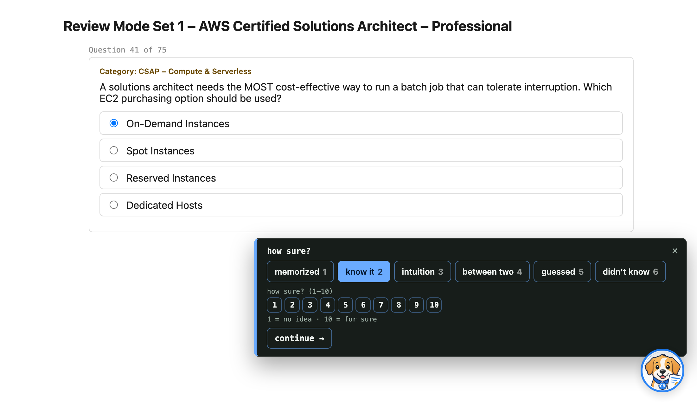
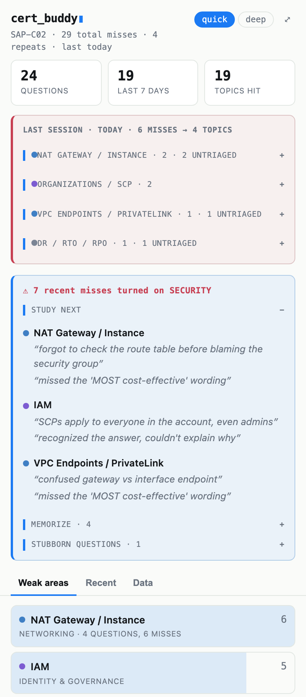
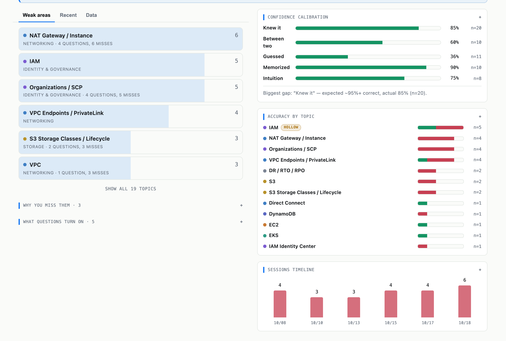

# Cert Buddy


A Chrome extension that tracks the practice-exam questions you miss, captured
automatically while you take the exam, then shows you which topics are costing
you points. No account, no server: everything stays in your browser.

I built it while preparing for the **AWS Certified Solutions Architect –
Professional (SAP-C02)** exam, which I passed in October 2026. It tracked about
570 practice questions across Tutorials Dojo and Udemy, saved a one-line "why I
missed it" note on almost every miss, and turned a score like 52/75 into a
short list of topics to fix.

| Quick mode: misses are captured silently | Deep mode: rate your confidence before the reveal |
| --- | --- |
|  |  |

| Dashboard | Insights |
| --- | --- |
|  |  |

## What it does

- **Captures every miss automatically.** When the practice site reveals an
  answer, Cert Buddy saves the question, your answer, the correct answer, the
  AWS topics involved, the phrase the question turns on ("MOST cost-effective",
  "LEAST operational overhead"), the question number, and how long you spent on
  it. Multi-select questions get partial credit (1/2).
- **Two capture modes**, switched from the popup header:
  - **Quick** (default) never interrupts you. Optionally tap a digit before you
    check your answer to log a gut confidence (1–9, 0 = 10). When a miss is
    captured, a small pill appears for a few seconds: click it or press **N**
    to jot down why.
  - **Deep** asks how sure you are *before* the answer is revealed: memorized,
    know it, intuition, between two, guessed, or didn't know, plus a 1–10
    scale. It holds your click until you answer, so the rating is a real
    prediction rather than a guess made after seeing the result. On a miss, it
    asks why.
- **Turns misses into a study plan.** After a set, the popup groups your misses
  by topic, ranks your weak areas, lists facts you marked to memorize, and
  flags questions you keep missing. On a retake, **✓ got it right** cools that
  topic; missing it again flags a regression.
- **Shows whether your confidence is calibrated.** The full-tab view (⤢)
  compares how sure you said you were with how often you were actually right,
  shows accuracy by topic, and marks topics where your correct answers were
  mostly memorized rather than understood.

## Install

Cert Buddy isn't on the Chrome Web Store yet, so you load it directly:

1. Download this repo: **Code → Download ZIP** and unzip it, or run
   `git clone https://github.com/melshae2/cert-buddy.git`.
2. Open `chrome://extensions`, turn on **Developer mode**, click **Load
   unpacked**, and select the folder.
3. Pin the extension, then open a practice exam.

After updating the code, click ⟳ on the extension's card and reload the exam
tab.

## Supported sites

| Site | Status |
| --- | --- |
| Tutorials Dojo practice exams (`portal.tutorialsdojo.com`) | Fully supported. This is where I used it most. |
| Udemy practice tests | Misses and results are captured. Question numbers usually aren't, and Deep mode's before-the-reveal prompt isn't verified on Udemy yet, so there it falls back to asking after the reveal. |
| Other sites | Open the popup and click **Enable logging on this page** to try a generic extractor. Results vary. |

## Using it

**During a set.** Answer questions as usual. In Quick mode that's all you have
to do. Keyboard shortcuts:

| Key | Does |
| --- | --- |
| `1`–`9`, `0` | Before checking your answer (Quick mode): log confidence 1–10 |
| `N` | While the "captured" pill shows: write why you missed it |
| `⌥M` / `Alt+M` | Open the full capture panel: edit answers and topics, pick a reason, add a fact to memorize |

**After a set.** Open the popup. Misses logged within 90 minutes of each other
form a session, and the debrief card shows that session clustered by topic
with your notes underneath. Review cluster by cluster, not question by
question. The tabs below hold your weak areas, a searchable list of every
record, and your data.

## Your data

- Everything is stored in `chrome.storage.local` in your browser. There is no
  account, no server, and no analytics, and the extension makes no network
  requests.
- **Permissions:** `storage` to save records; host access to `udemy.com` and
  `tutorialsdojo.com` to run on those sites; `activeTab` and `scripting` only
  when you click "Enable logging on this page" somewhere else.
- **Export is your backup.** Uninstalling the extension or clearing browser
  data deletes everything. Export JSON from the **Data** tab; the popup reminds
  you after 10 unexported misses and then every 14 days. A daily snapshot
  inside storage guards against corruption, not deletion.
- **Tip:** the export is plain JSON built to be analyzed. Give it to an AI
  assistant and ask which topics, question types, or confidence levels are
  costing you points. That's how I reviewed my sets.

## Known limitations

- **The topic list is for AWS SAP-C02.** On other exams, misses, notes, and
  confidence still record, but automatic topic tagging won't match and
  untagged misses don't appear in Weak areas. Support for other exams is the
  next planned feature.
- **It depends on each site's page structure.** A site redesign can break
  capture until the extractor in `src/content/adapters.js` is updated.
- Tested in Chrome. Other Chromium browsers (Edge, Brave) should work but
  haven't been tested.

## How it works

- **Per-site extractors** (`src/content/adapters.js`) read questions and
  answers from stable page hooks rather than generated class names. They only
  read *visible* elements, because both sites keep earlier questions hidden in
  the page.
- **Outcome detection** (`src/content/outcomes.js`) watches the page for the
  site's correct/incorrect result appearing, so nothing depends on you
  clicking a button.
- **Fingerprinting** (`src/lib/store.js`) identifies a question by its
  normalized text, so retaking a question merges into one record with a
  history of attempts instead of creating duplicates.

The commit history doubles as a changelog: each version's commit message
explains what changed and why.

## Development

There's no build step. To run the tests, serve the repo root:

```bash
python3 -m http.server 8642
```

Then open `http://localhost:8642/tests/test.html` for the pure-function suite,
or the fixture pages under `tests/harness/` to drive the content scripts
against mock Tutorials Dojo and Udemy pages (see `tests/harness/README.md`).

| Path | Job |
| --- | --- |
| `manifest.json` | Manifest V3; runs on Udemy and Tutorials Dojo |
| `src/lib/store.js` | Storage, fingerprinting, sessions, rankings, backups |
| `src/lib/taxonomy.js` | Topics and aliases, auto-tagger, reasons, discriminators |
| `src/lib/theme.js` | Shared design tokens for the in-page UI |
| `src/content/adapters.js` | Per-site question and answer extraction |
| `src/content/outcomes.js` | Outcome detection, capture modes, confidence prompts |
| `src/content/tagger.js` | Launcher and ⌥M capture panel |
| `src/popup/` | Dashboard and insights view |
| `tests/` | Pure-function tests and the browser harness |

## License

[MIT](LICENSE)
